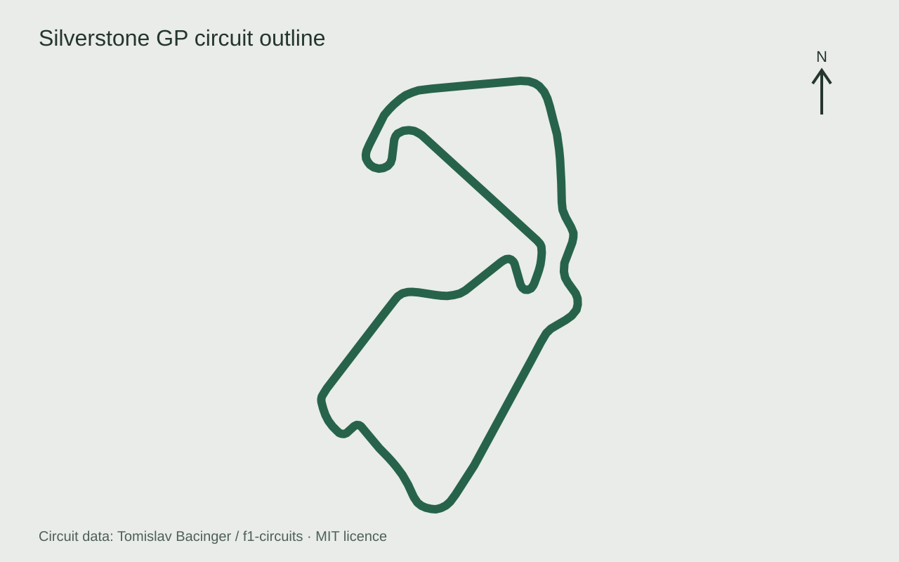
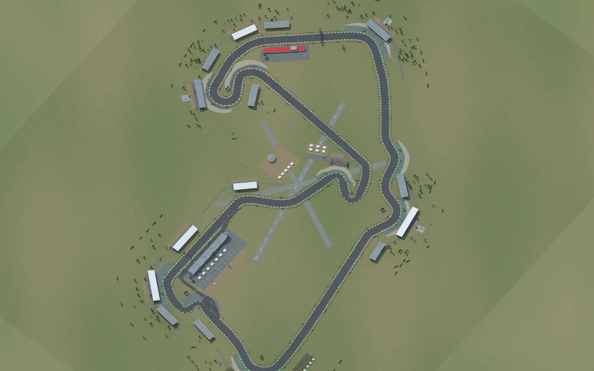
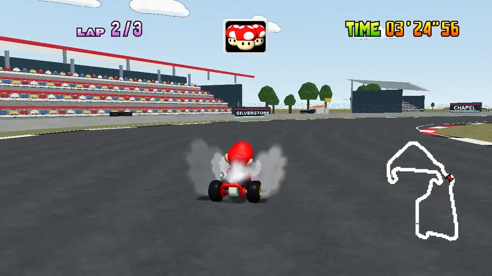
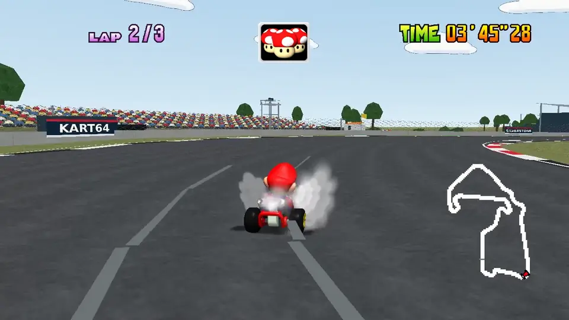

In the [previous post](/posts/mario-kart-64-on-my-phone/), I got Mario Kart 64 running on my phone.
But [SpaghettiKart](https://github.com/HarbourMasters/SpaghettiKart) also supports custom courses, and being a big Formula 1 fan, I couldn't leave that alone.
I wanted to see what a Mario Kart version of Silverstone could look like.
Maggotts, Becketts and Chapel, with Mario at the wheel.

I'd been curious about how much more capable frontier models seemed to be getting at working with Blender, 3D scenes and animation.
So last weekend, I decided to give GPT 6.1 Sol the task with the new Codex cloud environments, using a real circuit as the starting point.
The first layout came out better than I expected.
Getting the surroundings closer to what I had in mind took a different kind of reference, and a much more useful way to give the agent feedback.



> Maggotts, Becketts and Chapel in Mario Kart 64.

## Silverstone from above

We started by gathering map data and images together.
The [geographic circuit outline](https://github.com/bacinger/f1-circuits/blob/master/circuits/gb-1948.geojson), from Tomislav Bacinger's F1 circuits project, gave us the shape of the GP route.
Photographs supplied references for the buildings, stands and scenery around it.
That gave the agent enough to start building a recognisable circuit in Blender.

We had made great progress in an hour or so.
The layout itself was already quite good: the sequence of corners was there, and I could recognise the circuit.

 

> The geographic outline alongside a Blender render of the course. Map data: Tomislav Bacinger / f1-circuits, under the [MIT licence](circuit-data-LICENSE.txt).

The surroundings were where I wanted more work.
A map tells you where the road goes, and a photograph can show you a particular building, but I was judging this from the kart's camera.
I wanted to recognise what came into view as I approached a corner, what framed the turn, and how the scene opened up again on the exit.
Those views are connected when you're driving, and the initial references weren't conveying enough of that progression.

## Borrowing Max's view

Fortunately, Formula 1 gives us a rather good reference for this: onboard footage.
I used [Max Verstappen's 2025 Silverstone pole lap](https://www.formula1.com/en/video/onboard-max-verstappens-2025-pirelli-pole-position-award-lap-at-the-british-grand-prix.1836826066949110291), working through it frame by frame and turn by turn with the agent.
Instead of asking it to infer the surroundings from disconnected images, we could look at the approach, apex and exit in sequence.

I then got the agent to build side-by-side views of each corner, with the Mario Kart course alongside Max's onboard.
I could point to a particular view, explain what was missing or looked out of place, and have it work on that part of the circuit.
It could change the scene, rebuild the course and bring the comparison back for another look.
That made the critique much easier to act on.

Becketts was a good example of the kind of detail the onboard made useful.
The covered stand and the spread of spectators help frame the linked bends.
The scenery pass extended and covered the Becketts stand, then added groups around Becketts and Chapel.
At Stowe, the reference showed a broad spectator bank and a line of small white roofs; the course uses grassy banks, crowds and canopies to bring more of that into the view.

> Becketts in the native course, with the stand and spectators framing the bend.

> Stowe's broader spectator bank gives this part of the lap its own backdrop.

I wasn't trying to reproduce every structure or make the circuit photorealistic.
I wanted the surroundings to carry more of the character of each part of Silverstone, within a Mario Kart interpretation.
The onboard gave me something concrete to compare against, whilst leaving room to choose which details were worth translating into the course.

That was what I really liked about the comparisons.
“This doesn't quite look how I'd expect” could become feedback about a specific corner, roofline or sightline.
The agent had a reference and a part of the scene to work on, and I had a way to see whether its next attempt was closer to what I wanted.

## Max versus Mario

We also ended up with a continuous comparison of the two laps.
It brings the corners alongside one another as the lap progresses, so you can see the interpretation without one view disappearing down the next straight.



> [Verstappen's official F1 onboard](https://www.formula1.com/en/video/onboard-max-verstappens-2025-pirelli-pole-position-award-lap-at-the-british-grand-prix.1836826066949110291) at recorded speed; native Mario footage retimed to align approximate course landmarks.

The Mario footage changes speed between 23 visually reviewed checkpoints, covering the corner sequence and other landmarks.
Max's onboard stays at its original speed.

It makes a fun tour of the result, but it isn't a lap-time contest.
Max can keep his pole position.

## Making room for karts

The geographic outline gives us a centreline, rather than a complete surface that Mario Kart can race on.
The course pipeline resamples the roughly 5.89 km route into 842 waypoints, then builds the road and its edges around that path.
The waypoints also give the game's CPU racers a route to follow.
Blender and [Fast64](https://github.com/HarbourMasters/fast64) turn the scene into the geometry, collision, textures and path resources the source port can load.

The road is widened for kart racing, with a nominal width of 36 metres.
Tight bends need narrower sections: expanding a centreline equally on both sides can make the inside edges fold over one another where the road turns sharply.
That is one of the accommodations between the real outline and a course with room for Mario and seven rivals.
The corner sequence stays recognisable, whilst the dimensions serve the game.

Elevation is currently a shallow synthetic profile.
The geographic source gives us the route, but it doesn't mean the course reproduces Silverstone's actual rises and dips.
That's a part of the interpretation I'd like to refine further.

The visible scenery and the physical racing surface also need separate treatment.
Most of the runoff panels beyond the enclosing barriers are scenery, whereas the Wing pit shortcut has a physical asphalt route, walls, an entrance and a rejoin.
It bypasses Vale and Club; the CPU rivals keep following the normal GP route.

Even the export order affected that distinction.
In the pinned engine, collision-filter state carries between mesh loads, so the collision walls have to be exported before the floor meshes.
Putting the pit floors first could cause valid physical triangles to be discarded.
A scene can look like a perfectly usable shortcut whilst the game is missing the surface it needs to drive on.
That was a useful reminder that the Blender view is only one part of the course.

> Back towards the Wing and Hamilton Straight in native gameplay.

## Onto the grid

I decided to add custom-course access inside Kart64's game UI, so loading Silverstone doesn't require opening Blender.
After choosing a mode and driver, **Up** from the cup-selection row opens **Custom**.
The D-pad browses, **A** selects and confirms, and **B** returns to the original courses.

Time Trials keeps separate custom-course records and ghosts.
Grand Prix runs a standalone three-lap race against seven CPU rivals, with **Retry / Change Course / Quit** afterwards.
The original cups keep their normal progression.
This integration is built against Kart64's pinned SpaghettiKart version.

There's also a shortcut.
On the run from Stowe down to Vale, you can dive into the pit lane and race along the front of the Wing, crossing the line in the pit lane and rejoining before Abbey.
It skips Vale and Club and saves about 126 metres, and the CPU rivals stick to the track.



> A complete Silverstone lap at recorded speed, captured in native SpaghettiKart.

**Play Silverstone:** [Kart64](https://eddmann.com/kart64/), then press **Up** on the cup row.
**Course source in Kart64:** [courses/silverstone](https://github.com/eddmann/kart64/tree/main/courses/silverstone).
**Full course gallery:** [screenshots and videos](https://eddmann.com/kart64/courses/silverstone/media/).

Taking Becketts in Mario Kart was the bit that made me smile.
The first layout gave us a good starting point, and the onboard comparisons gave me a way to keep shaping the surroundings with the agent.
I could spend my time deciding what I wanted the course to look like, then look at the next version from the same part of the lap.

There's more I'd like to refine, especially the elevation.
But with an editable course, a scenery library and a process to try again, I'm already tempted by another circuit.
Eventually a whole Formula 1 calendar - a little Mario Kart F1 edition.
For now, Mario has Silverstone. 🏎️
